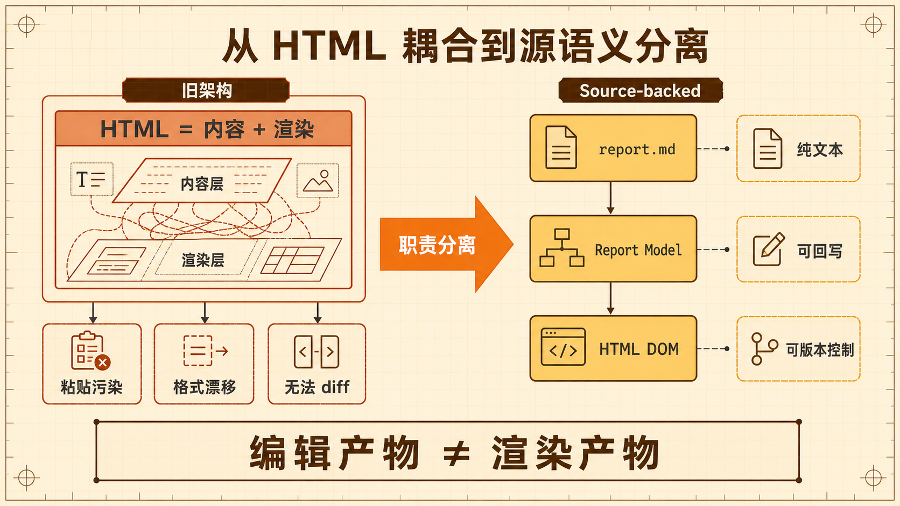
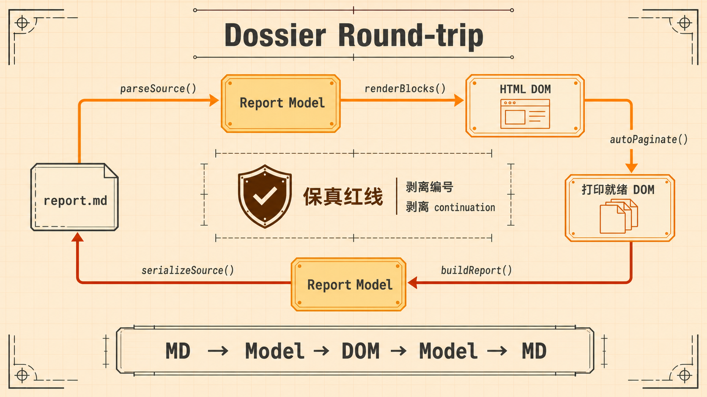
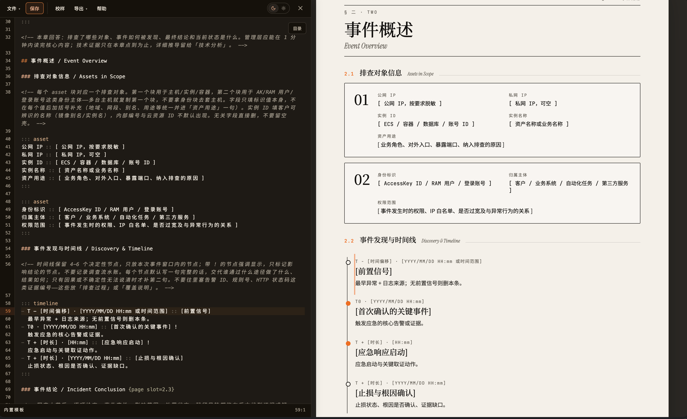
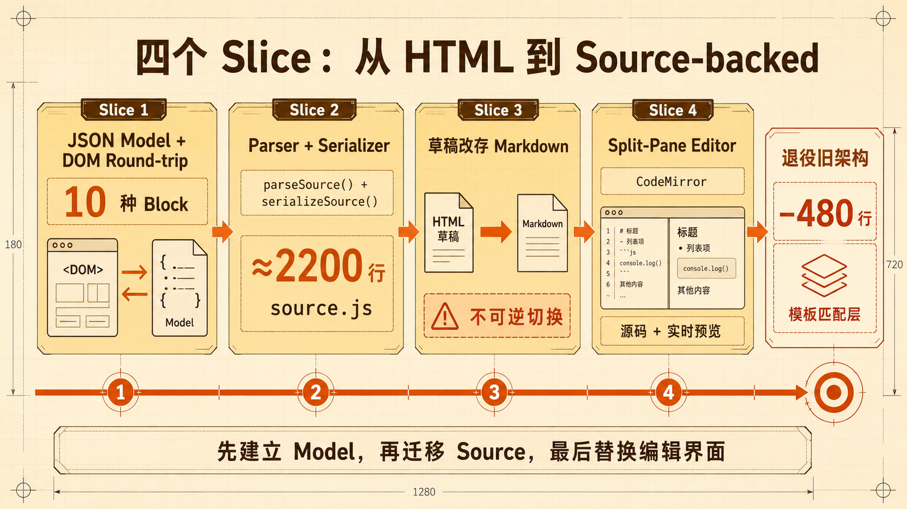
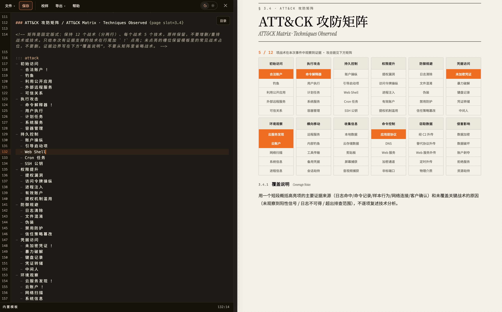
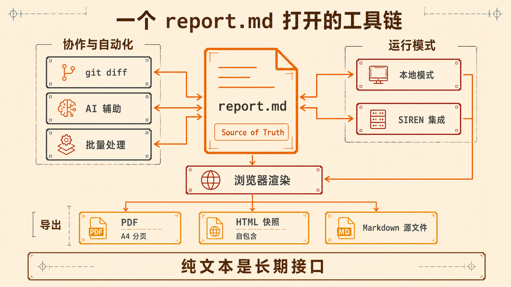

报告模板将就了太久。

<!--more-->

## 一、为什么要造 Dossier

应急响应有一个常被忽略的"最后一公里"：调查做完了，报告怎么写？

我们团队每次处理完安全事件后，都需要向客户交付一份正式的应急响应报告。报告里包含事件概述、排查时间线、受影响资产、攻击路径、处置动作和修复建议——结构固定，但每一份的内容完全不同。此前的做法是维护一套 Word 文档模板，响应人员复制一份出来，手动填写各个章节，最后导出 PDF 发给客户。

这个流程跑了很长一段时间，暴露出几个痛点：

- **格式不一致**：不同响应人员的排版习惯各异，粘贴截图、调整表格、对齐缩进、保持字体一致等操作耗费大量时间，最终产出的报告质量参差不齐
- **协作困难**：Word 文档模板每次复制后就变成独立副本，无法多人协作编辑同一份报告
- **AI 无从下手**：报告格式是富文本，不是纯文本——尽管可以解析 Word 的 XML，但对 AI 辅助写作和 diff 版本对比都不太友好

我们需要一个能在浏览器中协同编辑、离线可用、打印质量过关、源格式对 AI 友好的报告模板系统。这就是 Dossier 的由来。

## 二、第一版：contenteditable 的蜜月与破灭

最初的方案很直觉：一个单体 HTML 页面，用浏览器原生的 `contenteditable` 让用户直接在报告上编辑，IndexedDB 自动保存草稿，改完直接 `Ctrl+P` 打印 PDF。整个系统零后端、零依赖，双击 `index.html` 就能用。

这个方案上线后确实能用，我们在几次实际应急中用它交付了报告。然而随着使用次数增多，问题逐渐暴露：

**粘贴污染**：响应人员经常从 Word、在线文档、终端等来源粘贴内容到报告中。`contenteditable` 会原封不动地保留粘贴源的 HTML 标签——`<font>`、`<span style="mso-bidi-font-family:...">`、各种行内样式——这些"脏标签"会破坏报告的排版一致性，而且清理起来很痛苦。

**round-trip 不稳定**：保存到 IndexedDB 的是 innerHTML，再次加载渲染时，浏览器对同一段 HTML 的解析行为并不总是一致的。列表嵌套、空段落、连续空格等边界情况下，保存一次再打开，格式就可能发生微妙的漂移。

**无法版本控制**：报告的持久格式是 HTML，对人类来说几乎不可读，`git diff` 出来的结果毫无参考价值。

一句话概括：**编辑产物和渲染产物耦合在一起，是所有问题的根源。** 我们在 HTML 上同时承担了"内容存储"和"视觉渲染"两个职责，任何一方的需求变化都会牵连另一方。



## 三、架构转向：Markdown 负责内容，HTML 负责渲染

认识到这个根本矛盾之后，我们做出了 Dossier 最核心的架构决策：**将内容与渲染彻底分离。**

报告的持久结构应该存在于源语义中，而非偶然的 HTML 输出。具体来说：

- 一个 `report.md` 文件是报告的 source of truth，用一种我们称之为"Dossier Markdown"的格式编写
- 浏览器加载时，解析器将 `report.md` 转换为结构化的 Report Model（一组纯 JavaScript 对象）
- 渲染器将 Report Model 转换为 HTML DOM，分页引擎将其排布到 A4 页面上
- 保存时，反向构建器从 DOM 还原出 Report Model，序列化器将其写回 `report.md`

完整的数据流如下：

```
report.md
    ↓ parseSource()
Report Model
    ↓ renderBlocks()
HTML DOM
    ↓ autoPaginate()
分页后的打印就绪 DOM
    ↓ buildReport()（反向）
Report Model
    ↓ serializeSource()
report.md（回写）
```

这是一个完整的 **round-trip 循环**：MD → Model → DOM → Model → MD。我们将 round-trip 保真作为设计红线——任何一步都不能丢数据。自动生成的编号、分页产生的 continuation 标记等渲染副产物，在回写时必须被干净地剥离，不能渗漏回源文件。



### 为什么不用 MDX

MDX 将 JSX 组件语法引入 Markdown，但我们不需要那套东西。报告的结构化组件（时间线、资产卡、攻击矩阵等）是固定的十几种类型，不需要通用的组件系统。更重要的是，MDX 依赖编译工具链，而 Dossier 的设计目标是零依赖、双击即用。

我们选择了 `:::` 围栏指令（fenced directives）来表达报告专有结构。这个语法在 Markdown 社区中有先例（如 markdown-it-container），语义清晰，解析简单，不需要引入任何构建步骤。

### 为什么键值分隔符是 ` :: ` 而不是 `:`

报告中大量出现时间戳（如 `14:23`、`2025/05/07 09:15`），如果用 `:` 做键值分隔，解析器就无法区分"字段名 : 字段值"和"正文中出现的时间"。我们采用了 ` :: `（两侧各有空格的双冒号）作为分隔符，彻底避免了歧义。

## 四、分阶段实施

这次架构转向不是一次性完成的，而是分四个切片（slice）逐步推进。

### Slice 1：JSON Model + DOM Round-trip

第一步是在 HTML 编辑和 Markdown 之间架一座桥。我们定义了 10 种 Block 类型的数据模型（Heading、Narrative、Timeline、Phase、Asset、Attack 等），实现了 DOM → Report Model 和 Report Model → HTML 的双向转换。此时源文件还是 HTML，但数据模型已经就位。

### Slice 2：Source Language Parser + Serializer

第二步是发明 Dossier Markdown 语法本身。`source.js` 中实现了 `parseSource()` 和 `serializeSource()` 两个核心函数，加起来约 2200 行——这是整个项目最大的单个源文件，也是 round-trip 保真的关键所在。

### Slice 3：Drafts Persist as Source Language

第三步将草稿的存储格式从 HTML 切换为 Markdown。这是一个不可逆的决定——旧的 HTML 草稿直接作废。

### Slice 4：Split-Pane Source Editor

最后一步是在界面上加入左侧的源代码编辑面板。响应人员可以在左侧直接编辑 Markdown 源码，右侧实时预览渲染后的报告。编辑面板使用 CodeMirror，支持语法高亮、行号、搜索替换和错误诊断。



### 退役旧架构

在 Slice 4 稳定后，我们删掉了约 480 行的"模板匹配层"——这是早期从 HTML 模板中查找 slot 并填充内容的逻辑。从此，**报告完全从 Markdown 源生成**，HTML 模板只保留不可编辑的静态外壳（法律页、目录、页眉页脚）。



## 五、Dossier Markdown 语法示例

Dossier Markdown 在标准 Markdown 语法之上，增加了一组用 `:::` 围栏表达的报告结构指令。以下是几个典型组件的语法。

### 时间线

```markdown
::: timeline
- T0 · 2025/05/07 09:15 :: 云安全中心告警触发 !
  安全运营团队收到异常登录告警，确认非授权访问。
- T + 2h · 11:20 :: 应急响应启动 !
  启动应急流程，开始日志取证和影响范围评估。
- T + 6h · 15:30 :: 凭证吊销与止损
  完成 AccessKey 轮换和异常实例隔离。
:::
```

时间线中带 `!` 标记的节点会被强调显示。每个节点由时间标签、标题和正文组成，正文支持多段。

### 资产卡

```markdown
::: asset
公网 IP :: 203.0.113.xx
私网 IP :: 10.0.1.15
实例 ID :: web-prod-01
资产用途 :: 生产环境 Web 入口，暴露 80/443 端口
:::
```

多个 `:::asset` 块并排时自动合并为资产组。字段用 ` :: ` 分隔。

### 响应阶段与动作清单

```markdown
::: phase
title :: 抑制阶段 / Containment
- [x] 吊销泄露的 AccessKey 并轮换凭据
- [/] 隔离受影响实例的公网访问
- [ ] 检查 RAM 策略，收缩过宽权限
:::
```

动作项使用 `[x]`（完成）、`[/]`（进行中）、`[ ]`（未开始）三种状态标记，渲染时自动统计计数。

### 核心结论

```markdown
::: callout
label :: 核心结论
headline :: 云侧凭证疑似泄露
body :: 攻击者使用泄露的 AccessKey 完成云服务枚举与异常写入操作，已完成凭证轮换和访问隔离。
:::
```

### ATT&CK 矩阵

```markdown
::: attack
- 初始访问
  - 合法账户 !
  - 钓鱼
  - 利用公开应用
  - 外部远程服务
  - 可信关系
- 凭据访问
  - 未加密凭证 !
  - 暴力破解
  - 键盘记录
  - 凭证转储
  - 中间人
:::
```

12 个战术固定排列，技术名称后的 `!` 标记表示本次事件中有证据支撑的技术。渲染时未点亮的技术显示为低对比度占位，点亮的技术高亮显示。



### 源文件注释

```markdown
<!-- 写作提示：没有证据时写"未观察到"，不要补猜测。 -->
```

HTML 注释在源文件中可见，但不渲染到报告预览和导出的 PDF 中。我们用它来放写作提示和填充指南，帮助 AI 和响应人员正确填写各个章节。

## 六、设计系统

Dossier 的视觉设计围绕一个创意北极星：**法证卷宗（The Forensic Dossier）**。

报告页面使用暖色档案纸底色（`#f4f1ea`），标题使用 Noto Serif SC 传达权威感，正文使用 Noto Sans SC 保证可读性，时间戳和证据标签使用 JetBrains Mono，英文副标题使用 Instrument Serif。唯一的饱和强调色是公司的品牌橙色（`#ec6e22`），用于证据标记和关键操作。


一个重要的设计约束是**双表面规则**：报告页面和编辑面板是两套完全独立的色彩体系。报告永远是暖色档案纸，不支持暗色模式——打印结果必须和屏幕预览一致。编辑面板则有自己的暗色/亮色主题。所有编辑 UI（工具栏、面板边框、状态标记）在打印时完全消失。

分页引擎是纯 JavaScript 实现的 A4 自动分页。时间线、动作列表、表格等容器允许跨页拆分，但图片、资产卡、callout 等组件作为原子单元保持完整——如果放不下就整体移到下一页。稀疏页还有回填算法，避免出现大面积空白。

不过，分页引擎也是整个项目中踩坑最密集的模块。`pages.js` 从零增长到 867 行，经历了 20 余次专项修复。早期最隐蔽的 bug 是 `overflow: hidden`——它在垂直方向上实现了裁切分页，却在水平方向上静默吞掉了超宽内容（长哈希、长 URL），直到导出 PDF 后才发现文字被截断。引入自动分页后，新问题接踵而至：分页拆分出的续页排序错乱，保存后再加载时合并逻辑分不清"被分页拆开的容器"和"作者原本就写了两个相邻容器"。为此我们发明了 `data-split-cont` 标记来标识分页产生的续页，让 round-trip 合并有据可依。

后期模板匹配退役后，章节内容不再预分配到固定页面，全部交由 `autoPaginate()` 动态拆分，分页相关 bug 的密度反而陡增。稀疏页的回填算法有震荡风险——A 页的内容被移到 B 页，导致 B 页超限又要回移——最终不得不加上迭代次数上限，强制收敛。我们还引入了校样模式（proof），在编辑时就显示分页边界，让响应人员不必等到导出 PDF 才发现排版问题。

## 七、实际应用

### 两种运行模式

Dossier 支持本地独立和服务端集成两种模式。

**本地模式**下，双击 `index.html` 就能打开报告编辑（部分浏览器在 `file://` 协议下可能限制本地文件加载，此时需要 `python3 -m http.server` 起一个本地服务）。导出 HTML 快照时需要 HTTP 方式打开，因为 `file://` 下浏览器无法内联 CSS、字体等资源。`make dist` 可以将整个系统打包成 zip 分发给其他工程师。

**SIREN 集成模式**下，Dossier 部署到 SIREN 的指定目录，通过 SIREN 的 WebUI 集成。响应人员在 SIREN 的工作台中直接编辑报告，不需要单独管理文件。

### 与 AI 的协作

source-backed 架构带来的一个意外收获是 AI 辅助写作变得自然了。`report.md` 是纯文本，可以直接交给 AI 填充或改写。我们开发了一个名为 Sleuth 的 Skill，它使用 Dossier 的 `report.md` 作为种子模板，根据 SIREN 收集到的主机信息和日志自动生成报告初稿。响应人员在此基础上审阅和修改，效率比从空白模板开始写提升了不少。

这也验证了最初的设计判断：**选择纯文本作为持久格式，就是在为未来的所有工具链打开大门。** 版本控制（git diff 可读）、AI 辅助（直接输入/输出文本）、批量处理（脚本操作 Markdown 文件）——这些能力都是 source-backed 架构的自然结果。



### 导出

导出支持三种格式：

- **PDF**：通过浏览器打印，分页引擎确保每一页都精确裁切到 A4 尺寸
- **HTML 快照**：自包含的单文件 HTML，内联了 CSS、JavaScript、字体子集和 base64 编码的图片，双击即可打开继续编辑
- **Markdown 源文件**：直接下载 `report.md`，保留所有写作提示注释

HTML 快照的字体子集优化值得一提：导出时只嵌入文档中实际使用到的字符对应的字体子集，而不是完整的 Noto Serif SC / Noto Sans SC 字库。这让单份报告的 HTML 快照体积控制在合理范围内。

## 八、走过的弯路与收获

回顾这个项目四个月的开发过程，几个教训值得记下来。

**contenteditable 是一条看起来最短、实际上最远的路。** 它让原型阶段的进展非常快——几天就能编辑、保存、导出。但"编辑产物即渲染产物"这个前提假设从根本上限制了系统的演进空间。脏 HTML 的清洗、round-trip 的稳定性、版本控制的可读性，每一个问题都指向同一个根因。

**模板匹配是另一个弯路。** 在 Slice 1 和 Slice 2 之间，我们曾经维护了一套"从 HTML 模板中匹配 slot 并填充内容"的逻辑，约 480 行。这套东西随着报告结构的迭代越来越脆弱，最终在源生成架构稳定后被整体删除。早知道会走到源生成这一步，这 480 行可以完全省掉。

**round-trip 保真是值得坚守的红线。** 开发中有多次诱惑想"偷懒"——在序列化时丢弃某些信息、在解析时做有损的归一化。每一次我们都选择了把信息保全做到位。这个决定在后期收到了回报：任何编辑操作的结果都可以稳定地保存和还原，用户不会遇到"保存一次格式就变了"的问题。

**分离关注点后，好事会自然发生。** 当我们把"内容是什么"和"内容长什么样"拆开之后，AI 辅助、版本控制、批量处理这些能力不需要额外设计，它们就是纯文本格式的自然结果。回过头看，**形神兼备的关键不是同时做好两件事，而是让它们各司其职。**
